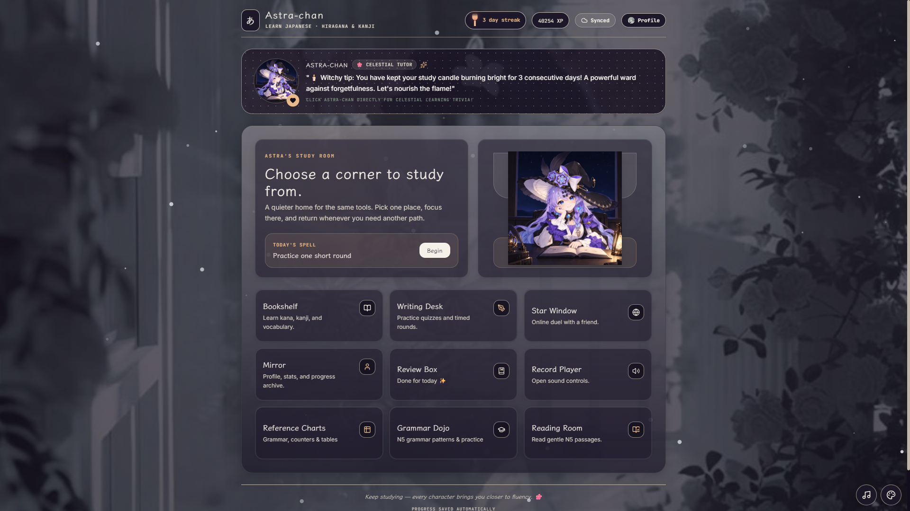
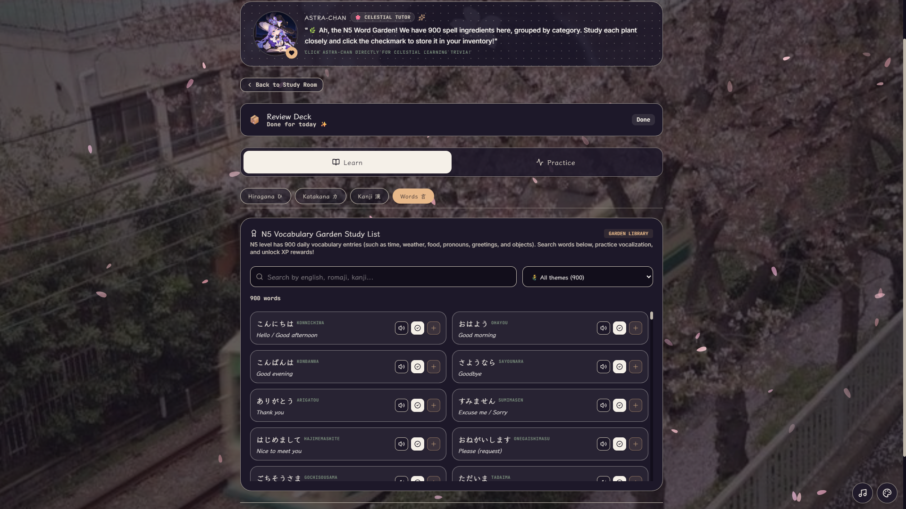
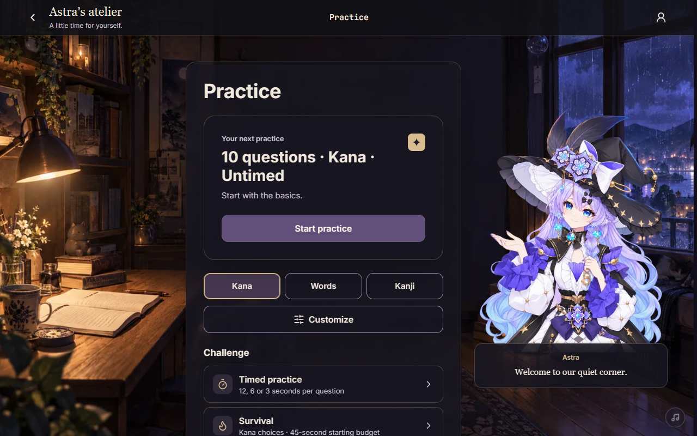
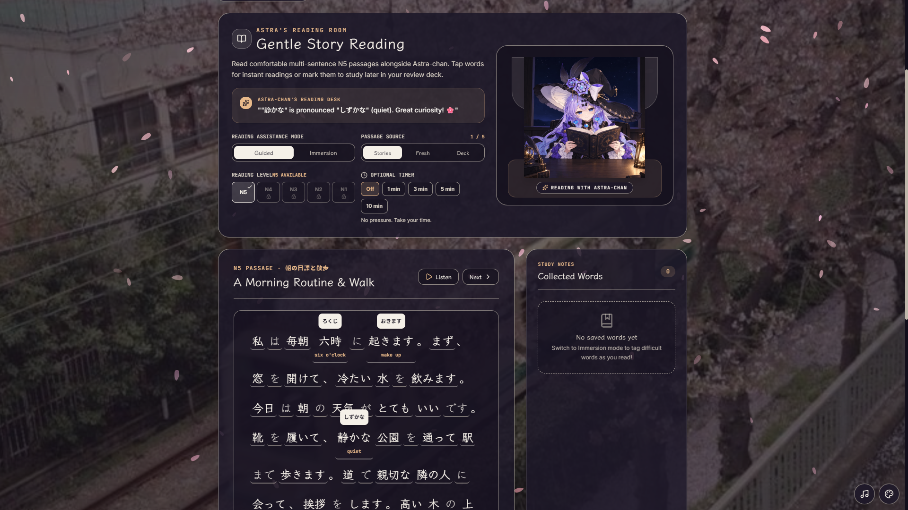
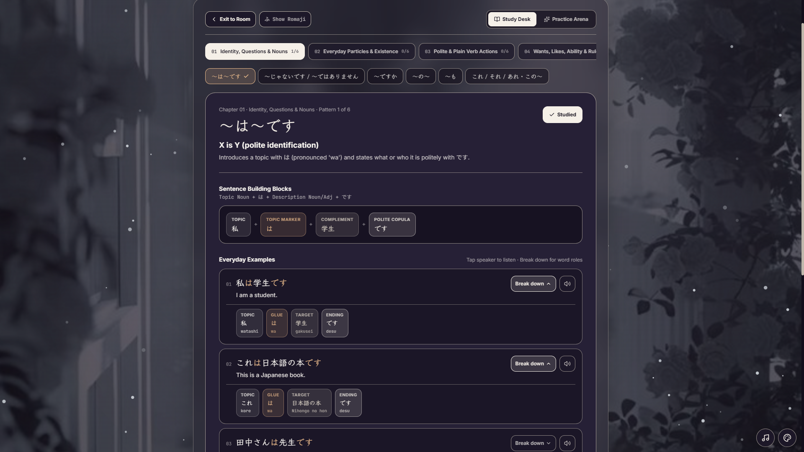
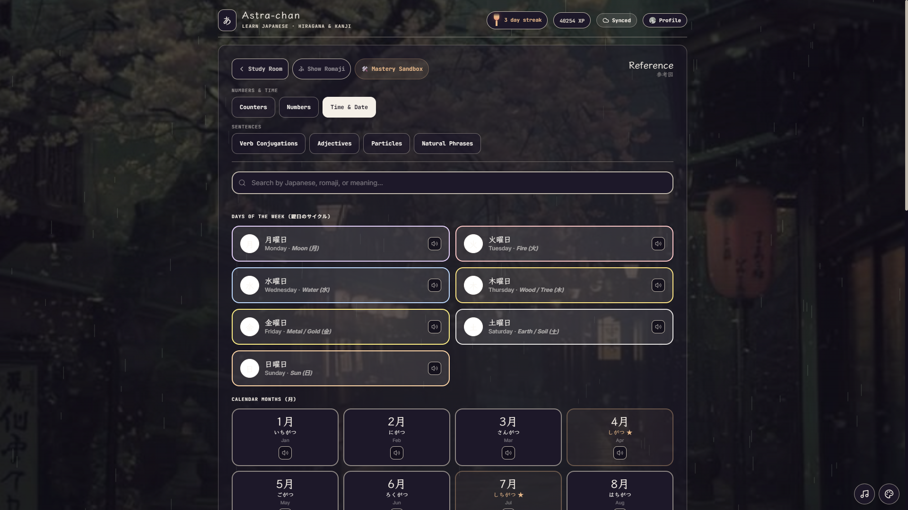
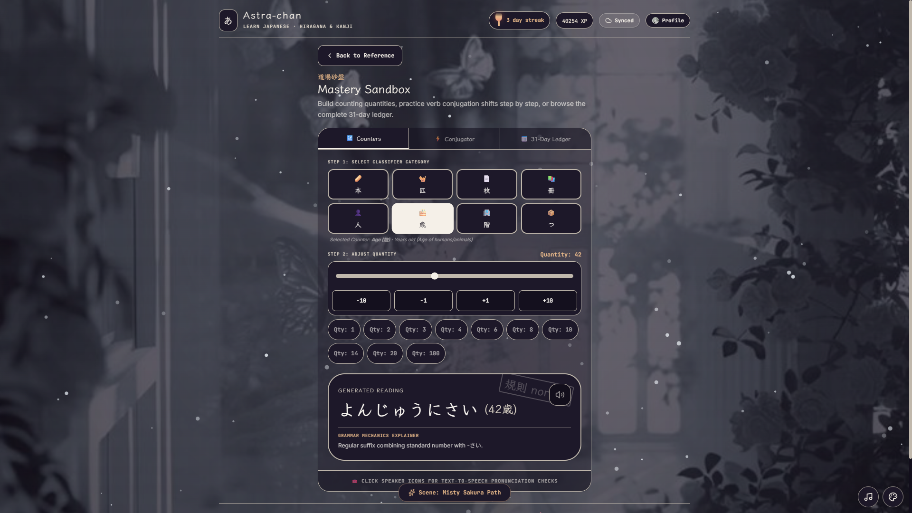
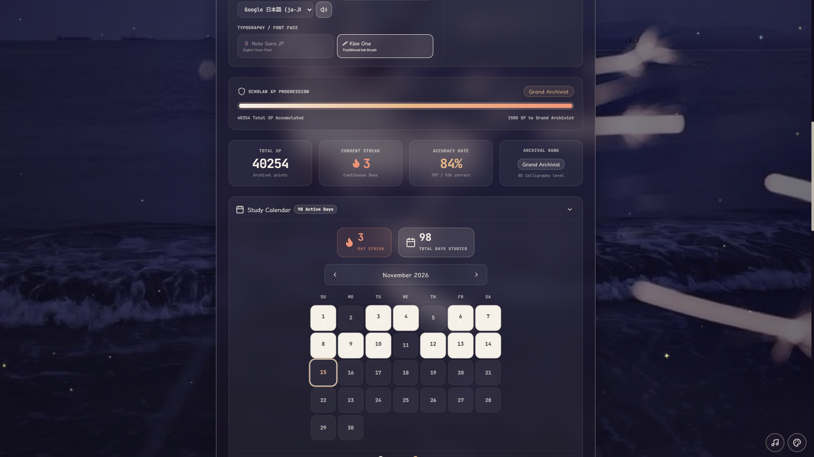
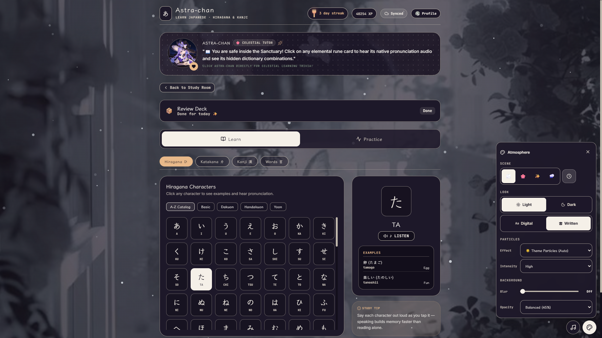
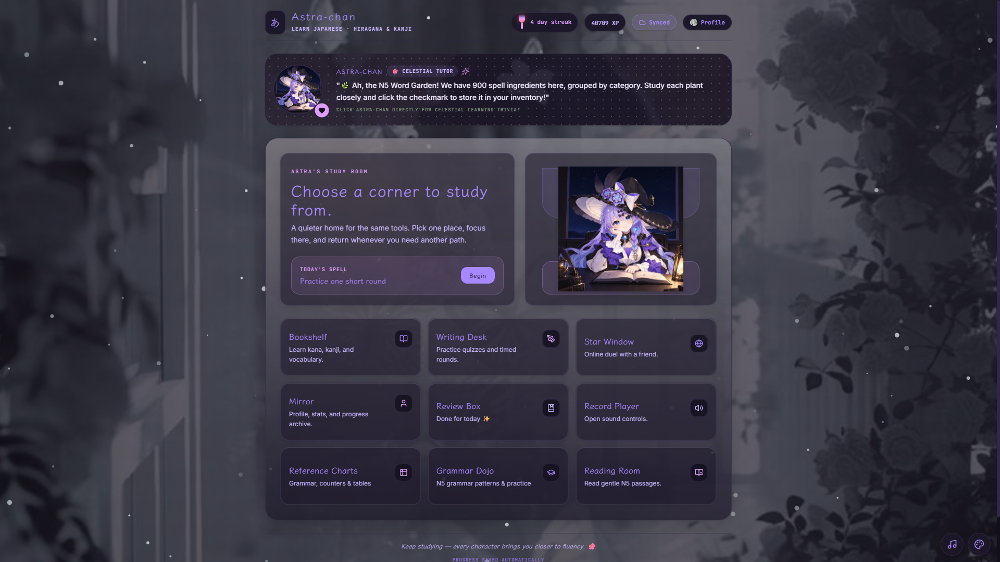

# 🌸 Astra-chan — Japanese Learning App

> *A cozy, magical Japanese learning companion — built with curiosity, stubbornness, and a lot of collaboration.*

**Live App → [astra-kanji-tutor.vercel.app](https://astra-kanji-tutor.vercel.app)**  
**GitHub → [github.com/late-shine/astra-chan-app](https://github.com/late-shine/astra-chan-app)**

> Status: Active personal project / learning app. Some features require Firebase and Google Gemini credentials.

<p align="center">
  <a href="#features">Features</a> ·
  <a href="#-spaced-repetition-srs">Spaced repetition</a> ·
  <a href="#the-story">The story</a> ·
  <a href="#how-i-work-with-ai">How it's built</a> ·
  <a href="#tech-stack">Tech stack</a> ·
  <a href="#setup-local-development">Run it locally</a> ·
  <a href="#roadmap">Roadmap</a>
</p>

**At a glance:** N5 Japanese · 145 kanji with stroke demonstrations · 900 vocabulary words · 28 grammar patterns across 5 chapters · reading passages · spaced repetition · online duels · 6 themes · English and Japanese interface



---

## The Story

This didn't start as a project. It started as a small experiment while Ashraful and I were learning Japanese.

I opened Claude and asked it to make a simple quiz. Ashraful was the one who asked, *"Can it add sound effects? Let me try."* It worked, so I tried too. Then came the dangerous question: *"Let's make it bigger. Let's see what it makes."*

That is how a tiny quiz became Astra-chan.

Ashraful and I did not build one app together. We built our own separate apps. We shared plans, features, ideas, and the architecture underneath them. When one of us tried something interesting, the other would borrow the idea, improve it, or argue for a better version. There was no gatekeeping; we regularly pushed each other to take good advice. Astra-chan is my app, but that shared creative pressure is part of its story.

What followed was about a week of intense building — roughly 4 to 5 hours every day, sometimes more. I became completely absorbed in breaking things, fixing them, adding features, redesigning them, and occasionally breaking them again. By the time I first uploaded it to GitHub, around 8 days had passed. Not months. One focused, obsessive week.

I did not write the code line by line myself. I decided what to build, how it should feel, what was worth adding and what was not, when something looked wrong, and when a technically impressive idea would make the app worse for a beginner. The project taught me that knowing *what to ask*, what to reject, and what to test is its own skill.

The app grew from a single HTML file into a full-stack learning space with multiplayer, AI-assisted kanji drawing feedback, spaced repetition, Firebase sync, grammar and reference tools, reading practice, and a mascot companion named **Astra-chan** — whose artwork was generated by Gemini after many, many attempts.

### How I work with AI

I use AI as a group of collaborators, not as an autopilot. Different models help with architecture, implementation, research, design criticism, and verification, but I make the product decisions and test the result in the running app.

The workflow evolved over time. I first used one model to build and verify. Later I separated planning from implementation, and eventually separated building from verification. That made it easier to catch assumptions, compare different approaches, and keep Astra's visual language consistent.

Large changes now move through a small, repeatable loop: define a phase, keep a current context file and codebase map, let one builder implement the phase and write a handoff, have a different verifier inspect the actual diff, then run the commands and browser checks myself. Fresh AI sessions can continue from the handoff without rereading the whole project.

This process is slower than accepting the first generated answer, but it makes the app easier to improve without losing track of what changed.

Some moments worth mentioning:

- When the background images and music came together for the first time, something clicked. It stopped feeling like a quiz app and started feeling like a *place*.
- Different models kept different parts of the project honest. One would propose a design, another would find the confusing part, and I would test the result before deciding whether either suggestion belonged in the app.
- The multiplayer system took the longest. I checked Firebase guidance with more than one model and researched API-key security before trusting the deployment. Nothing important was accepted just because one model sounded confident.
- The Study Room redesign changed everything. Instead of menus and tabs, the home screen became Astra-chan's room — a Bookshelf, a Writing Desk, a Star Window. Navigation as a place to be, not a list to scroll through.
- Astra-chan now reacts when you go AFK. She starts wondering after 15 seconds of silence, shifts into deep AFK after 35 seconds total, and lights up when you return. She also reacts while you practise: focused during a question, pleased after a correct answer, encouraging after a mistake or timeout, and supportive after repeated misses when you pause.
- The kanji drawing feedback went through two model generations. The original used Cloudflare Workers AI with LLaVA 1.5 7B — a vision model that technically worked, but gave vague or inaccurate structural feedback. I switched it to **Google Gemini**, now using a fallback chain beginning with Gemini 3.8 Flash and stepping through 3.6 Flash, 3.5 Flash-Lite, 3.1 Flash-Lite, and the 2.5 Flash models when a model is unavailable, rate-limited, or too slow (each attempt has its own time limit, so the checker answers within about 35 seconds). The feedback stays specific enough to explain what looked off, alongside a separate KanjiVG-based stroke demonstration.

This is still being built. It probably always will be.

### Splitting App.tsx — a case study in AI-directed refactoring

This section describes an earlier refactor. The current quiz screens share QuizFlow/Duel views; superseded screens and the development-only prototype are no longer part of the app.

By the time the feature list above was mostly done, `App.tsx` had grown to
**7,625 lines** — one giant component holding ~90 pieces of state and every
screen's JSX in a single function scope. It worked, but it was becoming
impossible to hand to any AI session without burning half the context
window just reading it.

The fix took **9 phases**, each one extracting a single screen
(`menu`, `results`, `vocab-quiz`, `kanji-quiz`, `quiz`, `kanji-scroll`,
`profile`, `review-deck`, `online-multiplayer`) into its own component under
`src/components/`, using plain prop-passing — no Context, no state
libraries, nothing that would risk subtly changing behavior.

The workflow for each phase:
1. One Claude session (the reviewing Claude) reads the current `App.tsx`,
   identifies the next screen's exact line boundaries and every piece of
   state/handler it touches, and writes a detailed, scoped prompt — what to
   read, what *not* to read, what must never move, and the exact output
   format expected.
2. That prompt gets handed to Codex, which does the actual extraction.
3. The result comes back to Claude for verification (line counts, bracket
   balance, cross-screen state checks) before moving to the next phase.

A few things made this harder than "just move the JSX":
- Several screens shared state with each other — `currentKanjiIndex` was
  used both inside the `kanji-scroll` screen and in the mascot companion
  render outside it; the friend-invite system was shared between `profile`
  and `online-multiplayer`. Each had to be identified and kept in `App.tsx`,
  passed down as props to both consumers, rather than moved.
- The `online-multiplayer` screen (the final and biggest phase, ~983 lines)
  had state driven by `useEffect` hooks handling Firebase room
  subscriptions — logic that had to stay in `App.tsx` regardless of where
  the JSX lived, which inverted the usual "move anything self-contained"
  instinct from every earlier phase.
- One early Codex session burned through its usage limit fighting its own
  PowerShell string-escaping and a self-created symlink to an external
  `node_modules` folder, without producing a final result. The fix wasn't a
  cleverer prompt — it was adding an explicit "work efficiently" section to
  every prompt after that: no scripted string replacement, no full
  project-wide lint/build runs chasing unrelated pre-existing errors, do the
  edit once.

End result: `App.tsx` was cut nearly in half, with 9 new screen components and zero behavior changes — verified phase by phase by actually clicking through the app, not just trusting a clean build.

---

### Rebuilding the Review Deck — a case study in phased, verified changes

The first spaced repetition system worked, but it was simple: five levels, a wrong answer dropped a card one level, and tapping the Review Box started a session with **every** due card. After a few weeks away that could mean hundreds of cards in one sitting, which is the fastest way to make someone stop reviewing.

I did not ask for a rewrite in one go. An earlier plan from another AI was checked against the real code and revised, and the work became **five phases**:

| Phase | What it changed |
|---|---|
| **S1** | A pure scheduling engine (`src/srsScheduler.ts`) with a nine-step ladder, and a safer cross-device merge based on last review time instead of due time |
| **S2** | A daily session: limits for reviews and new cards, a 10-minute relearn step, and honest "Today" counts |
| **S3** | Three grades (Forgot / Hard / Got it), per-card ease, interval previews, a level ring and a 7-day forecast |
| **S4** | Tricky cards that are set aside after repeated misses, and an optional backlog recovery tool |
| **S5** | Fixing a key collision so the kanji 山 and the word 山 can both be cards, with a migration for existing decks |

How it was kept safe:
- The scheduler is a plain module with no React, storage, or Firebase inside it, so it can be tested alone. `scripts/srs-sim.ts` replays decks and a 365-day simulation as a long list of checks; it can also read an exported backup and report what would change, without writing anything.
- Existing decks had to load unchanged: every card keeps its level and due time, and new fields are optional.
- One Claude session built each phase and a separate one reviewed it. I ran the real lint, build, and simulation checks, then used the running app. Several decisions came from that last step, not from the code: after a real session, I noticed a forgotten card could come back three times and, near the end of a session, straight away. That became a written open decision instead of a silent change.
- The S5 problem was found by reading the code before building (41 vocabulary words are also single kanji), so it was planned as its own phase with a migration rather than patched in passing.

---

## Why I Built This

I am an 18-year-old CST diploma student from Bangladesh, learning Japanese while hoping to study and eventually live in Japan. Japan represents more than a career destination to me: a quieter life, beautiful nature, and a place to breathe. I am aiming toward MEXT scholarship and KOSEN admission.

Building a Japanese learning app while learning Japanese felt like the most honest thing I could do. Astra is designed for the version of me who wants to study seriously, but still needs the experience to feel calm, visual, and a little magical.

---

## Features

The current app combines the original learning tools with the Rainlit Atelier practice room, personal-miss repair, and friendly kana, word, and kanji duels. Feature descriptions below describe the product itself; setup and usage still depend on the services listed later in this README.

### 🏠 Study Room Navigation
The home screen is Astra-chan's room — each object is a destination:
- **Bookshelf** — Learn hiragana, katakana, kanji, and vocabulary
- **Writing Desk** — Practice quizzes and timed rounds
- **Star Window** — Online duel with a friend
- **Mirror** — Profile, stats, and progress archive
- **Review Box** — SRS review deck with today's session summary (reviews, new cards, estimated time)
- **Record Player** — Music and atmosphere controls available from every screen
- **Guided Study Room Tour** — a short five-step introduction to the main study areas, shown on a learner's first visit
- **Reference Charts** — Grammar tables and quick reference
- **Grammar Dojo** — N5 grammar patterns and practice

### 📚 Learning
- **Hiragana & Katakana** — full character grids with pronunciation, flashcard mode, and example words
- **Kanji** — 145 current N5-level single-character cards with meanings, readings, stroke count, and example sentences. A **Digital / Written / Compare** specimen shows the same kanji in a clean gothic font and a handwriting-style font side by side, and a recall mode hides meanings and readings so you can test yourself
- **N5 Vocabulary** — 900 words across 12 categories: greetings, expressions, time, places, food, people, actions, adjectives, objects, school, body, and weather
- **Daily Spell** — a suggested next action shown on the home screen each session

<p align="center">
  
</p>

### 🎯 Practice & Quiz

Practice opens **Rainlit Atelier**: Astra's rainy nighttime study room, with one recommended session and secondary Customize/challenge controls. The visual scope covers Practice, quiz setup/player/recovery/results and friendly duels. Study Room, Learn, Grammar, Reading and SRS retain their existing interfaces. Every saved theme ID uses the same night palette inside the atelier. Phone artwork and speech share one bounded companion panel; no portrait-position/size editor ships.

- **Untimed normal practice**, correct-only auto-next ON by default after1.6s. Wrong answers/timeouts wait for Next; interaction can pause auto-next. Timed and Survival have explicit clocks rather than hidden adaptive difficulty.
- **Kana:** read, pick kana, type romaji or Mixed; Hiragana/Katakana/Both and Core/Dakuten/Handakuten/Yōon groups. Four choices, with an acknowledged six-choice option for eligible kana pools. Typed aliases are item-specific, not fuzzy matching.
- **Words:** Meaning, Reading, Reverse or Mixed; public themes, manually Learned words and custom selections. Reading does not reveal its reading/audio before grading.
- **Kanji:** Meaning, On’yomi, Kun’yomi, isolated Mixed, and explicit **In words · Curated set**. The current audited context pool supports60 distinct whole words from13 families/64 source entries. In words teaches the complete reading, not invented per-kanji segmentation.
- **Length:**10 /20 /30 /All eligible targets. Ordinary sessions use each selected target once, including Mixed. All is blocked if the eligible pool exceeds the existing256-question recovery bound; it is not silently truncated. Survival repeats its frozen bank.
- **Challenges:** solo timed Kana12/6/3s, Words/Kanji20/10s; Survival is kana choice with45s initial budget,60s cap, correct+5s and wrong−8s. Survival correct feedback uses0.9s; mistakes remain manual.
- **Growth:** first-try accuracy stays separate from repair. Practice remaining misses in batches of up to5 frozen same-kind questions. Add missed items to Review Deck explicitly, with dedupe and existing daily introduction limits; adding a card does not schedule an immediate introduction.
- **Astra's dialogue:** locally authored English and decorative expressions, not AI chat/TTS. During solo quizzes she responds to the current question, correct answers, mistakes, timeouts, results, and repeated misses. A third consecutive solo mistake can offer gentle support within a cooldown/cap; timed/Survival support waits for explicit pause. Her reactions do not change questions, difficulty, rewards or clocks, and duels use generic entry/results only.
- **Manual mastery stays manual:** word quiz answers never tick garden learned flags; kanji quiz answers never consume the separate once-per-kanji Study+40 reward or change manual mastery. Kana first-pass practice still updates its glyph accuracy.

#### Quiz XP

| Accepted record | XP |
|---|---|
| Ordinary/timed correct choice |15; Quick+5, kana Lightning+10 |
| Ordinary/timed correct typed kana |25; same timed bonuses |
| Survival correct choice |15 |
| Correct repair |5; repair counters only |
| Completed ordinary/timed practice with≥10 unique first-pass targets |20 once |
| Duel own accepted correct choice / typed kana |15 /25; Hard+5, kana Superhard+10 |
| Wrong, timeout, unattempted |0 |

No response-speed multiplier or win bonus. Partial/repair/Survival/duel sessions have no completion bonus. First-pass wrong/timeout still counts as an attempt and study activity; opponent-claimed/unshown duel rounds do not. Repair does not inflate global first-try attempts/accuracy.

#### Saving and recovery

A confirmed local save writes progress and its receipt together. **Saved on this device** is separate from **cloud sync pending**. Account records queue for the existing cloud writer; refresh/reconnect uses ordered receipts rather than paying the same answer twice. Recovery is owner-scoped, with a24h/512KiB solo snapshot and a separate bounded current-duel learning journal, so a duel does not overwrite saved solo practice. Backup import replaces current-owner recovery/outbox state before adopting imported totals; browsing old history does not replay rewards.

Storage-denied/full browsers show Retry and an explicit Continue without recovery choice. In-memory progress can be lost when the page closes. No fresh offline-install cache or service worker is promised: locally loaded quiz content can work without network, while a first uncached page load still needs its assets. Existing aggregate cross-device merging does not guarantee an exact history when multiple devices study concurrently.

The separate **Kanji Practice Station** still provides Watch /Trace /Write /Review with optional AI-assisted drawing feedback, real stroke paths and the existing reduced-motion controls. It is outside the quiz engine. The learning Word Family panel remains a curated reference, not an exhaustive dictionary.

<p align="center">
  
</p>

### 📖 Reading Room
- **N5 Reading Passages** — gentle multi-sentence stories built from the app's Japanese vocabulary and grammar
- **Guided & Immersion Modes** — reveal readings and meanings while learning, or read independently and mark unfamiliar words
- **Tap-to-Explore Words** — inspect readings and meanings directly inside each passage
- **Optional Reading Timer** — choose no limit or a 1 / 3 / 5 / 10 minute session
- **Comprehension Checks** — answer questions after selected N5 passages and review your result
- **Personal Reading Notes** — keep a session list of words you marked as difficult
- **Review Deck Integration** — add individual missed words or all collected words to the SRS Review Deck
- **Astra-chan Reading Companion** — Astra reads alongside you, reacts when called, and returns to her book after a short conversation
- **Future Levels** — N4 through N1 are shown as planned levels and will unlock in future updates

<p align="center">
  
</p>

### 🥋 Grammar Dojo
- **28 Core N5 Grammar Patterns across 5 progressive chapters** — detailed structural guides with full explanations, syntax breakdowns, and cultural tips
- **Rich Media Support** — interactive audio pronunciation (🔊 TTS) for all grammar formulas and example sentences
- **Fill-in-the-Blank Quizzes** — dynamic grammar quiz mode to test and solidify your understanding of patterns in context
- **Search & Filter Controls** — instantly query and filter patterns by category, difficulty (Basic vs. Intermediate), or search terms
- **Bilingual Romaji Toggle** — flexible reading displays designed to accommodate both total beginners and advanced learners

<p align="center">
  
</p>

### 📊 Reference Charts
- **Comprehensive N5 Tables** — beautifully laid-out reference grids covering Japanese numbers, counters, time, verb groups, adjectives, and particles
- **Pronunciation Audio & Romaji** — quick-access audio buttons and romaji visibility options for every row
- **Tricky Counting & Euphonic Rules** — clear explanations for complex phonetic modifications (e.g., ふん vs ぷん, irregular days of the month, and counting exceptions)
- **Natural Conversation Phrases** — 50+ common expressions such as うん, どうしよう？, え、ほんと？, おつかれ！, やばい, and めっちゃ, with romaji, English meaning, register labels, usage notes, caution notes, and pronunciation audio
- **Phrase Search & Filters** — search by Japanese, romaji, or meaning and filter by casual, polite, neutral, slang, or conversation category
- **Conversation Examples** — selected phrases include short Japanese dialogues with English glosses to show how they sound in context

<p align="center">
  
</p>

### 🛠️ Interactive Mastery Sandbox
- **Dynamic Quantity Builder** — select any number and match it with N5 counter categories (pens, animals, people, etc.) to view automatic euphonic sound modifications and explanations
- **Step-by-Step Verb Worksheet** — conjugate root verbs live by applying past, negative, polite, or negative-te suffixes, seeing conjugations react instantly
- **Immersive 31-Day Ledger** — a complete interactive calendar visualizer to review irregular monthly date readings and listen to natural audio pronunciations

<p align="center">
  
</p>

### 🔁 Spaced Repetition (SRS)
- **Personal Review Deck** — add any word or kanji, or the words you missed in the Reading Room. A kanji and a word that share a character (like 山) are separate cards
- **Nine-step schedule** — 8 hours → 1 → 3 → 7 → 14 → 30 → 60 → 120 → 240 days (never more than a year), with a small ±12% spread on longer intervals so cards do not all return on the same day
- **Three-button grading** — **Forgot / Hard / Got it**, each showing when the card will come back. Every card also remembers how easy you find it, so easy cards space out faster and hard ones return sooner
- **Relearning** — a forgotten card drops back and returns later in the same session (about ten minutes later); the re-show earns no extra XP
- **A session that fits in a day** — 50 reviews and 10 new cards by default, adjustable from the gear in the Review Deck (up to no limit). The home screen shows a line like "Today: 25 reviews · 5 new · about 5 min", extra cards simply wait, and "Study N more" is there when you want to go further
- **Level ring and 7-day forecast** — see how well a card is known, and how many reviews are coming over the next week
- **Tricky cards** — a card you have forgotten six times is set aside so it stops crowding your sessions. A small flag opens the list, where you can put a card back (starting again at level 0) or remove it
- **Backlog recovery** — if you have been away and are far behind, an optional tool, with a confirmation that shows the exact number, spreads the most overdue cards over the coming days instead of facing you with one huge pile
- **Safe with old data and across devices** — decks from before the rebuild load with their levels and due dates intact; signed-in devices merge by most recent review instead of overwriting each other; the daily limits follow your account
- XP is awarded for every first-time answer in a session, and total reviews count toward badges like *Deck Master*

### 🌐 Online Multiplayer

Friendly two-player **protocol2** rooms use a6-character code and the atelier. Both players agree on the current public set and press Ready; changing subject, type, timer or set clears both readiness states. Both clients should update/refresh; old-protocol rooms are rejected before joining.

- **Supported:** Kana read/type; Words meaning/reading/reverse; Kanji meaning/on. Four choices; no mixed, audio, kun or context questions in duels. Public all/theme/explicit sets only; no shared knowledge or learned/studied comparison.
- **Counts:**5 /10 /20, shrinking to the actual eligible unique targets; minimum5. The host freezes every question and option/order once, and the guest plays that snapshot.
- **Competitive:** first accepted correct claims one match point; a round already claimed before you answer is unattempted. Two wrong answers or expiry can resolve without a point. Shared starts/deadlines keep running through hidden tabs/disconnections.
- **Parallel:** independently answer the complete set. Correct count wins, then lower total response time across all answers, including full-duration timeouts; exact equality ties. Words/Kanji default to Parallel.
- **Timers:** Kana15/10/5/3s; Words/Kanji20/15/10s, no Superhard. Both modes are available.
- **Recovery/results:** per-connection presence and persisted index/deadline; explicit leave or qualifying connection loss gives partial counts with no invented winner. Rematch keeps members but clears the old manifest/answers/Ready and creates a fresh match ID. History uses that ID, records actual totals/partial status, and leaves older entries readable.
- **Personal learning:** only confirmed own correct/wrong/timeout records affect your study progress. Match points and study XP are separate. No win/completion bonus; Practice my misses uses actual own misses and is disabled with an explanation when local catalog mapping is unavailable.
- Existing friend requests, notifications, room invites and response tracking remain. No learning history is published for set selection.

### 👤 Profile, Voice Control & Bilingual Support
- **Optional Cloud Account** — create an account with email/password or Google from the visible account shortcut or Profile; the existing anonymous Firebase identity is upgraded without changing the user's friend code when possible
- **Cloud Progress Sync** — XP, streaks, mastery, vocabulary progress, SRS cards and daily limits, study dates, survival records, reading notes, and guided-tour progress sync to the user's private Firebase progress record. Display name and avatar stay consistent across devices
- **Account Recovery** — email/password users can request a Firebase password-reset link without visiting the Firebase Console
- **Synced Preferences** — theme, font, language, romaji and kanji-form choices, practice grid, auto-pronounce, voice mode, the chosen Gemini voice, and the atmosphere settings follow the account. The browser's own Japanese voice, music track and volume, ambient sound, and the current background scene stay on each device
- **Offline Fallback** — local browser storage remains available when the user is not signed in or temporarily offline
- **Dual-Language Interface** — complete bilingual support! Toggle the entire application interface between English and Japanese with a single click
- **Hybrid Japanese Voice Engine** — choose fixed Gemini Japanese voices from Astra's catalog, or use browser voices for free/offline playback; Gemini TTS tries the 3.8 Flash-Lite and Flash models before legacy fallbacks, then the browser engine if every Gemini attempt is unavailable
- **Monthly Study Calendar** — detailed tracking calendar showing daily active study streaks, streak counts, and XP milestones
- **Mastery Badges** — earn 10 distinct unlockable achievement badges celebrating your progress (e.g., *First Steps*, *Survivor*, *Week Warrior*, *Deck Master*, *N5 Scholar*)
- **Durable Backup/Restore** — download all stats, vocabulary decks, and unlocked milestones to a JSON file and restore your state at any time
- **Recent Duels** — online match history showing opponent, score, result, date, difficulty, mode, and round count
- **Friend Request Inbox** — accept/decline requests from Profile, with a visible notification badge when new requests arrive

<p align="center">
  
  
</p>

### 🎨 Atmosphere & Mascot
- **5 Animated Background Scenes** — dynamic visual themes depicting different times of day and seasons
- **Tailored Weather & Magic Particles** — cozy falling snow, delicate cherry blossom (sakura) petals, glowing magical sparkles, gentle rain, and floating Japanese runes
- **Fluid Crossfade Transitions** — a physics-based, continuous lerped canvas transition system that gracefully crossfades particle states during scene switches (no sudden jumps, especially between snow and cherry blossoms!)
- **Auto-Cycle Scenes Mode** — a cozy toggle option to cycle through the beautiful background scenes automatically every minute, with persistence saved in local storage
- **Atmosphere controls** — 5 gorgeous music tracks, custom background blur, opacity, and intensity controls
- **Theme & Fonts** — 6 full visual themes (Light, Dark, 🔮 Cosmic Witch, 🎋 Emerald Jade, 🍁 Autumn Maple, 🌌 Cyber Tokyo), each with its own color palette and matching shift in Astra-chan's personality and dialogue, plus a premium typography selector (Noto Sans JP / Klee One)

<p align="center">
  
</p>

- **Astra-chan** — animated mascot with mood system, speech bubbles, and AFK reactions:
  - Goes wondering after 15 seconds of no interaction
  - Goes into deep AFK mode after 35 seconds total (20 seconds after wondering)
  - Lights up with excitement when you return
  - Reacts to solo quiz questions, answers, timeouts, results, and repeated misses
  - Five artwork states with smooth crossfade transitions: default, wondering while you are away, excited when you return, reading, and reading-clicked

---

## Tech Stack

| Layer | Technology |
|---|---|
| Frontend | React 19 + TypeScript |
| Build | Vite |
| Styling | TailwindCSS v4 |
| Animation | Framer Motion |
| Database | Firebase Realtime Database |
| Auth | Firebase Anonymous Auth + optional Email/Password and Google accounts |
| Voice | Browser Speech Synthesis + Gemini 3.8 Flash-Lite/Flash TTS with legacy fallbacks |
| AI Feedback | Google Gemini Flash fallback chain (optional vision feedback) |
| Stroke Data | KanjiVG-derived stroke paths (CC BY-SA 3.0) |
| Deployment | Vercel (serverless functions for API proxy) |
| Icons | Lucide React |
| Checks | `tsc --noEmit`, plus plain `tsx` simulation scripts for the SRS scheduler and account sync (`scripts/srs-sim.ts`, `scripts/acc-sim.ts`) |

## Credits & Licenses

- **Astra's own code and content** are covered by the [LICENSE](LICENSE) in this repository (All Rights Reserved — personal use permitted).
- Astra-chan's artwork was generated with Gemini.

### Third-party data and attribution

The stroke demonstrations use adapted **KanjiVG** data by Ulrich Apel and contributors from the
20260714 release. The KanjiVG-derived data is released under the [Creative Commons Attribution-ShareAlike 3.0
license](https://creativecommons.org/licenses/by-sa/3.0/). Astra's stroke display and animation
are adaptations for this app; the original project and source are linked from the in-app notice and
the `src/kanjiStrokes/NOTICE.md` file.

- [KanjiVG source repository](https://github.com/KanjiVG/kanjivg)
- [KanjiVG project site](https://kanjivg.tagaini.net/)
- [CC BY-SA 3.0 license](https://creativecommons.org/licenses/by-sa/3.0/)

This notice applies to the KanjiVG-derived stroke data, not automatically to every part of Astra. The stroke data can be regenerated with `npx tsx scripts/build-kanji-strokes.ts` (the script's header explains the arguments).

---

## AI collaboration

This project was built through AI collaboration, but not through blind automation. I directed the product, made the design calls, tested the running app, compared competing suggestions, and kept the final say. The models wrote much of the code; I owned the decisions and the responsibility for what stayed.

| Collaborator | How it contributed |
|---|---|
| **Claude** | Architecture, implementation, visual experiments, and independent review |
| **Codex** | Scoped edits, code review, regression checks, and implementation support |
| **Google AI Studio + Gemini** | Early builds, kanji/vocabulary work, Astra-chan artwork, visual experiments, and optional kanji feedback |
| **Kimi** | Additional debugging and bug-finding passes |
| **ChatGPT, DeepSeek, Grok, Perplexity, Netlify, Copilot, Openclaw, Codeium, OneCompiler** | Research, comparison, deployment guidance, technical references, isolated checks, and alternative perspectives |
| **Lovable** | Design exploration and an early profile prototype |
| **Qoder** | UI design exploration for the kanji study flow |

The list matters less than the method: describe a real goal, give the collaborator only the necessary context, inspect what it returns, run it, look at it, and decide whether it actually helps a learner. A confident answer is not the same thing as a verified answer.


---

## What I Learned

- How to break a large problem into phases small enough for an AI to handle reliably
- That a prompt isn't memory — plans, context files, and handoffs are what let a brand-new chat pick up where the last one stopped
- When to trust an AI's output and when to verify it with a different one
- That "it passed" and "it's right" are different sentences — a clean build can't tell you whether the screen actually looks right
- That a simulation script catches what clicking around can't (a year of reviews in seconds), and clicking around catches what the script can't (a card coming back three times in one sitting)
- That design decisions, product decisions, and debugging instincts can't be delegated — those stayed with me
- That building something for yourself, for a real reason, makes every frustrating session worth it
- That the best portfolio piece isn't the most technically impressive one — it's the one with a real story behind it
- That one focused week, if you care enough, can produce something you're genuinely proud of

---

## Setup (Local Development)

> **Known requirements:** multiplayer needs Firebase Realtime Database and Firebase Anonymous Auth. Cross-device progress sync additionally requires Firebase Email/Password or Google Auth and the private `userProgress/$uid` database rule. Kanji-drawing AI feedback and the optional fixed Gemini voice catalog use the server-side Google Gemini API key; browser voices remain available without it.

```bash
git clone https://github.com/late-shine/astra-chan-app.git
cd astra-chan-app
npm install
cp .env.example .env
# Fill in your Firebase and Gemini API keys
npm run dev
```

### Environment Variables
```
VITE_FIREBASE_API_KEY=
VITE_FIREBASE_AUTH_DOMAIN=
VITE_FIREBASE_PROJECT_ID=
VITE_FIREBASE_DATABASE_URL=
VITE_FIREBASE_STORAGE_BUCKET=
VITE_FIREBASE_MESSAGING_SENDER_ID=
VITE_FIREBASE_APP_ID=
GEMINI_API_KEY=
GEMINI_TTS_MODEL=gemini-3.8-flash-lite-tts
```

Enable **Email/Password** and **Google** under Firebase Console → **Authentication → Sign-in method** if you want account creation and cloud progress sync. Password-reset emails use Firebase Authentication's built-in email action and can be customized under **Authentication → Templates**. Apply the complete rules from `database.rules.json` to Firebase Realtime Database. The `userProgress/$uid` path is private to the authenticated owner.

When using the Firebase CLI, publish database rules with:

```bash
firebase deploy --only database
```

For the fixed Astra Gemini voice catalog, add the same server-side `GEMINI_API_KEY` to the local `.env` file and Vercel Environment Variables. `GEMINI_TTS_MODEL` is optional and defaults to `gemini-3.8-flash-lite-tts`; the server falls back through Gemini 3.8 Flash TTS, Gemini 3.1 Flash TTS, and Gemini 2.5 Flash TTS when the selected model is unavailable or rate-limited. Never use a `VITE_` prefix for the Gemini key. If every Gemini TTS attempt is unavailable, Astra falls back to the browser voice engine.

> Get a free Gemini API key at [aistudio.google.com](https://aistudio.google.com). Gemini limits vary by model, project, and time window; if the voice quota is reached, Astra automatically uses the browser voice instead.

> ⚠️ **AI drawing analysis limit:** The drawing checker tries several Gemini Flash models when one is unavailable, rate-limited, or slow. On Google's free tier the two strongest models allow only about 20 requests per day each, so most checks end up on the Flash-Lite models; if every quota is used up, the checker shows a friendly message until a window resets. The chain can be changed without a code edit via the optional `GEMINI_ANALYSIS_MODELS` environment variable.

### Useful commands

```bash
npm run dev        # run the app locally
npm run lint       # type-check (tsc --noEmit)
npm run build      # production build
npx tsx scripts/srs-sim.ts       # SRS scheduler checks and 365-day simulation
npx tsx scripts/srs-sim.ts backup.json   # optional: read-only report on an exported backup
npx tsx scripts/acc-sim.ts       # account/profile/preferences sync checks
```

The ordinary app mounts the regular experience in both development and production builds.

### Firebase Realtime Database Paths

Online multiplayer and account sync use Firebase Authentication and these Realtime Database paths:

- `rooms`
- `friends`
- `friendRequests`
- `invites`
- `inviteResponses`
- `matchHistory`
- `userProfiles`
- `userProgress` — private study-progress record for each signed-in account

`matchHistory` records finalized protocol2 matches by fresh match ID, including partial endings with a manifest. Older entries remain readable; missing historical matches/rewards are not reconstructed retroactively.

### Multiplayer security boundary

Authentication/rules protect membership IDs, invite ownership, profiles and private progress paths. The client derives answer role from the authenticated UID. However, participants have parent-level room write grants: manifests, grading and timing remain friendly **client-scored** data, not a server referee or tournament anti-cheat guarantee. Signed-in users with a waiting-room code can read its public setup; rematch removes old question/answer payloads before waiting. Public set agreement never compares private learning histories.

The app adds no new database path or rules change in the current release. Existing installations do not need a Firebase console re-paste; fresh Firebase projects still need the checked-in rules during initial setup. If a future change edits `database.rules.json`, update the Firebase console as part of that change. Pending sync and existing concurrent-device aggregate merge limits still apply.

---

## Roadmap

- [x] Study Room visual redesign (navigation as Astra-chan's room)
- [x] Floating Music and Atmosphere controls available across screens
- [x] Guided first-visit Study Room tour
- [x] Reference Charts (counters, particles, verb groups, adjectives, time)
- [x] Natural Conversation Phrases in Reference Charts with register filters and usage examples
- [x] Grammar Dojo with N5 patterns and fill-in-the-blank practice
- [x] Spaced Repetition System (SRS)
- [x] Review Deck rebuild in five phases — nine-step ladder, daily limits, three-grade review, forecast, tricky cards, backlog recovery, and separate kanji and word cards
- [x] Synced preferences and consistent profile name and avatar across devices
- [x] Online multiplayer — competitive and parallel modes
- [x] Optional email/password and Google accounts with Firebase cloud progress sync and password recovery
- [x] Hybrid Japanese voice system with fixed Gemini TTS voices and browser fallback
- [x] Rainlit Atelier Practice/solo/duels, three-subject quiz settings, authored companion and personal-misses repair
- [x] Streak calendar and achievement badges
- [x] Progress backup and restore
- [x] Astra-chan mascot states: default, wondering/AFK waiting, excited return, reading, and reading-clicked artwork
- [x] Kanji drawing feedback — originally Cloudflare Workers AI (LLaVA 1.5 7B), upgraded to a **Gemini Flash fallback chain** after accuracy issues with the original model
- [x] Romaji toggle for beginners across Grammar Dojo and Reference Charts
- [x] App component splitting across 9 phases (described above; later features continued to evolve `App.tsx`)
- [x] Interactive Mastery Sandbox (counter builder, verb conjugation worksheet, 31-day calendar ledger — built as interactive tools rather than literal user-created tables)
- [x] Kanji Word Family panel (reading-grouped vocabulary deep-dive, 13 curated kanji and 64 words so far)
- [x] KanjiVG stroke demonstrations with attribution and reduced-motion support
- [x] Beginner-focused UI simplification pass for the kanji study screen and word-family panel
- [x] Kanji study screen overhaul — clearer card, Digital/Written/Compare specimen, practice station (Watch / Trace / Write / Review)
- [x] Cleaner kanji data — audit script, structured reading records, high-confidence reading fixes
- [x] 6-theme visual system (Light, Dark, Cosmic Witch, Emerald Jade, Autumn Maple, Cyber Tokyo)
- [x] Reading Room with N5 passages, Guided/Immersion modes, optional timers, comprehension checks, and SRS notes
- [x] Two-way friend request system with accept/decline flow and profile notifications
- [x] Online duel match history
- [x] Same-room rematch / Play Again flow
- [x] Auth-derived multiplayer answer attribution
- [x] Curated solo In words reading quiz (60 eligible whole words; independent Japanese semantic review remains pending)
- [ ] N4 vocabulary expansion
- [ ] Mobile app version

---

## Built By

**Shahriya** — CST Diploma student, Bangladesh, 18

Astra-chan is my app. Ashraful is my friend, fellow Japanese learner, and the person who asked
*"what if we make it bigger?"* at the beginning. We built separate apps, but shared ideas,
architecture, criticism, and encouragement without gatekeeping.

The code was developed with AI collaborators. The direction, testing, design judgment, and final
decisions stayed with me.

*"I would rather try and fail than never try at all."*

---

<p align="center">
  Made with 🌸 lots of green tea and way too many AI chat windows
</p>
